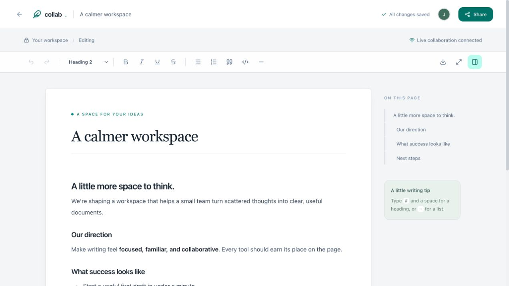
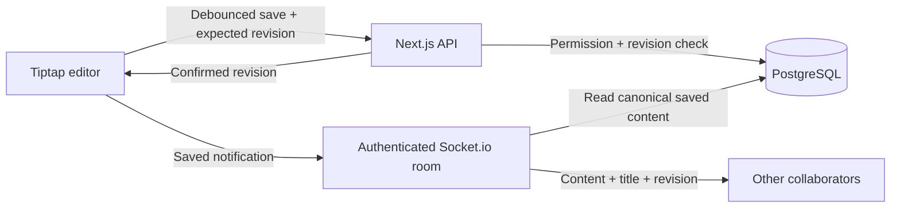

# Collab Editor

**A little space for big ideas.** A thoughtfully designed document workspace with a no-account demo, rich text editing, permission-based sharing, and live updates after successful saves.

[Live site](https://collab-editor-sand.vercel.app) · [Try the editor locally](#try-it-locally) · [Engineering details](#how-collaboration-works)



## Explore in two minutes

1. Open `/demo` and edit the sample document. No account or database is required for the demo.
2. Try **focus mode**, navigate with the **document outline**, and **download Markdown**.
3. Create an account for the full workspace: start from a blank page, project brief, or meeting notes; search, sort, and switch between grid and list views.
4. Open **Share** on a document you own. Add another registered account by email with **Can view** or **Can edit**, then send them the copied document link.

The demo saves only in that browser's local storage. Account documents save to PostgreSQL. Sharing adds access; it does not send an email invitation.

## What’s implemented

- Responsive landing page and sign-in experience with an immediately usable editor demo.
- Tiptap rich text: headings, bold, italic, underline, lists, quotes, code blocks, and undo/redo.
- Document outline, focus mode, word/character counts, reading time, and Markdown export.
- Document templates, search, sorting, owned/shared filters, and keyboard-accessible document actions.
- Debounced autosave with truthful saving/error states, retry, unsaved-change warnings, and stale-write protection.
- Owner-managed sharing, read-only editing restrictions, and authenticated live presence.
- Validated inputs, document-scoped socket authorization, and database permission checks.
- Regression tests for permissions, socket isolation, document validation, export, and overlapping saves.

## How collaboration works



1. A local change becomes a dirty draft. After a one-second pause, the client saves it with the revision it last read.
2. The API checks permission and revision in the same database write. A stale draft receives `409`, preserving the local text for review/export.
3. Only after a successful save does the client notify its socket room. The server reads the document from PostgreSQL and broadcasts the saved version, never trusting client-supplied content or identity.
4. Clients apply newer remote revisions when they have no local changes. Conflicting local changes remain available instead of being silently overwritten. Updates received during a pending save are reconciled against its response.
5. Socket authorization uses a short-lived document-specific ticket from the authenticated Next.js API. Room joins, edit notifications, and broadcasts check access; revoked participants are removed before subsequent content broadcasts.

This is **save-based collaboration, not character-by-character CRDT editing**. Simultaneous edits can require a manual reload after exporting the local draft. The socket service keeps presence in memory and is designed for a single instance. The editor displays connected collaborators; the transport retains cursor events, but this release does not render remote cursor overlays.

## Try it locally

Requires **Node.js 20.9+**. PostgreSQL is needed for accounts and saved documents; `/demo` works without a database.

```bash
git clone https://github.com/felmonon/collab-editor.git
cd collab-editor
npm ci
cp .env.example .env
```

Set `DATABASE_URL` to your PostgreSQL database and generate a strong `NEXTAUTH_SECRET`:

```bash
openssl rand -base64 32
```

Then prepare the database and start both services:

```bash
npm run prisma:generate
npm run prisma:push
npm run dev:all
```

Open [localhost:3000](http://localhost:3000), or go straight to [the demo](http://localhost:3000/demo).

| Variable                      | Purpose                                                                       |
| ----------------------------- | ----------------------------------------------------------------------------- |
| `DATABASE_URL`                | Same PostgreSQL database for Next.js and the socket service                   |
| `NEXTAUTH_SECRET`             | Same strong secret in both services; signs sessions and collaboration tickets |
| `NEXTAUTH_URL`                | Next.js origin, e.g. `http://localhost:3000`                                  |
| `NEXT_PUBLIC_APP_URL`         | Allowed app origin for the socket service                                     |
| `NEXT_PUBLIC_SOCKET_URL`      | Browser-visible socket origin, e.g. `http://localhost:3001`                   |
| `SOCKET_PORT` / `PORT`        | Socket listening port; default `3001`                                         |
| `GITHUB_ID` / `GITHUB_SECRET` | Optional GitHub OAuth; leave blank to hide the button                         |
| `GOOGLE_ID` / `GOOGLE_SECRET` | Optional Google OAuth; leave blank to hide the button                         |

`next dev` loads `.env` automatically. The standalone socket service also loads Next.js environment files. Never commit real credentials. Use `prisma db push` only for local setup or an appropriately planned schema change.

## Verify

```bash
npm run lint
npm run typecheck
npm test
npm run build
```

Tests use Node’s test runner through `tsx`. Socket tests start a real local Socket.io server and clients with controlled document storage; they do not require PostgreSQL. Autosave tests cover newer remote notifications arriving before delayed HTTP responses, continued typing during saves, and title normalization.

For a manual two-user check: create two local accounts, share a document as view-only, verify editing is disabled, upgrade the share to edit, reopen it, edit from one account, and observe the saved revision in the other. Make overlapping edits to check that stale saves are rejected.

## Deployment

Deploy the Next.js app to Vercel and the Socket.io process as a separate persistent service. `render.yaml` provides the socket service definition. Both need the same database and `NEXTAUTH_SECRET`. Configure `NEXT_PUBLIC_SOCKET_URL` before building the web app; set `NEXT_PUBLIC_APP_URL` on the socket service to the exact deployed web origin.

If the socket service is unavailable, account documents can still save through the API; the interface reports collaboration as unavailable. A reconnect loads the latest saved revision.

Before using this portfolio project as a production team service, add managed password recovery, account verification, abuse controls, operational monitoring, and a migration/deployment strategy. Version-history tables exist in the schema, but no version-history UI is claimed. Google/GitHub OAuth requires your own provider configuration.

## Stack

Next.js 16 · React 19 · TypeScript · Tailwind CSS 4 · Tiptap 3 · Socket.io · NextAuth · Prisma · PostgreSQL

## License

MIT
